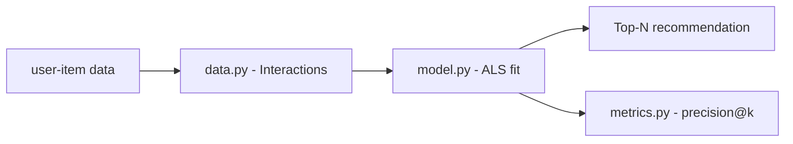

# recomendador-produtos-ml

**English** · [Português (Brasil)](README.md)

[](#) [](#) [](#) [](#) [](LICENSE)

## What it is

A **product recommender built on collaborative filtering** with **ALS** (Alternating Least Squares) from the `implicit` library. The lab loads user-item interactions (`user_id`, `item_id`, rating), trains an ALS model and generates Top-N recommendations, with evaluation metrics (precision@k etc.). It is an educational ML project focused on recommendations.

## Status

An educational ML lab, working and tested (16 tests).

## Features

- **Interaction loading and preparation** (`data.py`): `Interactions` + `load_interactions` (DataFrame → user/item/rating), `build_user_item_matrix`.
- **ALS model** (`model.py`, class `Recommender`): `fit`, `recommend` and `recommend_items` (Top-N per user).
- **Metrics** (`metrics.py`): recommendation evaluation (precision@k and more).
- **Programmatic API**: importable via `recomendador_produtos_ml` (no CLI).

## Architecture

Three modules: `data` (preparation), `model` (ALS/implicit) and `metrics` (evaluation). The `Recommender` takes `Interactions`, trains and exposes recommendations.



## Stack

- Python ≥ 3.10
- pandas ≥ 2.0, numpy ≥ 1.24, scipy ≥ 1.10
- implicit ≥ 0.7 (ALS)
- pytest (dev)

## Repository layout

```
recomendador-produtos-ml/
├── pyproject.toml · BRIEF.md
├── src/recomendador_produtos_ml/
│   ├── data.py      # interactions + user-item matrix
│   ├── model.py     # Recommender (ALS)
│   └── metrics.py   # evaluation
├── tests/           # 16 tests
└── LICENSE          # MIT
```

## Prerequisites and installation

Python ≥ 3.10.

```bash
pip install -e .
```

## How to run

Programmatic use (no CLI):

```python
from recomendador_produtos_ml.data import load_interactions
from recomendador_produtos_ml.model import Recommender

df = ...  # DataFrame with user_id, item_id, rating
interactions = load_interactions(df)
rec = Recommender().fit(interactions)
print(rec.recommend_items(1, n=10))
```

## Tests and quality

Real command (verified by the agent):

```bash
PYTHONPATH=src python -m pytest tests/
# 16 passed
```

## Technical decisions and trade-offs

- **ALS (implicit)** for collaborative filtering: efficient on sparse interaction data; the cost is the `implicit` dependency.
- **Interaction data instead of item features**: a classic recommendation model, without content/attributes.

## Known limitations and roadmap

- No packaged CLI/data entry (use via import).
- Recommendations by interaction only (cold-start and new items are out of scope).
- No deployment/service.

## Development process

An individual project by Kelvin Oliveira, built with orchestrated AI agents and reviewed by the author. The ALS modeling and the review are the author's.

## License and author

MIT — Copyright (c) 2026 Kelvin Rebelo de Oliveira.

**Author**: [Kelvin Oliveira](https://github.com/KelvinOliveiraCode) · [Portfolio](https://kelvinoliveiracode.github.io/portfolio/)
