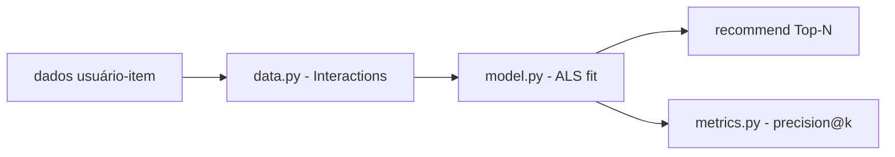

# recomendador-produtos-ml

[English](README.en.md) · **Português (Brasil)**

[](#) [](#) [](#) [](#) [](LICENSE)

## O que é

**Recomendador de produtos por filtragem colaborativa** usando **ALS** (Alternating Least Squares) da biblioteca `implicit`. O lab carrega interações usuário-item (`user_id`, `item_id`, avaliação), treina um modelo ALS e gera recomendações Top-N, com métricas de avaliação (precision@k etc.). É um projeto de ML educativo focado em recomendações.

## Status

Laboratório educacional de ML, funcional e testado (16 testes).

## Funcionalidades

- **Carregamento e preparação de interações** (`data.py`): `Interactions` + `load_interactions` (DataFrame → user/item/rating), `build_user_item_matrix`.
- **Modelo ALS** (`model.py`, classe `Recommender`): `fit`, `recommend` e `recommend_items` (Top-N por usuário).
- **Métricas** (`metrics.py`): avaliação de recomendação (precision@k e afins).
- **API programática**: importável via `recomendador_produtos_ml` (sem CLI).

## Arquitetura

Três módulos: `data` (preparação), `model` (ALS/implicit) e `metrics` (avaliação). O `Recommender` recebe `Interactions`, treina e expõe recomendações.



## Stack

- Python ≥ 3.10
- pandas ≥ 2.0, numpy ≥ 1.24, scipy ≥ 1.10
- implicit ≥ 0.7 (ALS)
- pytest (dev)

## Estrutura do repositório

```
recomendador-produtos-ml/
├── pyproject.toml · BRIEF.md
├── src/recomendador_produtos_ml/
│   ├── data.py      # interações + matriz usuário-item
│   ├── model.py     # Recommender (ALS)
│   └── metrics.py   # avaliação
├── tests/           # 16 testes
└── LICENSE          # MIT
```

## Pré-requisitos e instalação

Python ≥ 3.10.

```bash
pip install -e .
```

## Como executar

Uso programático (não há CLI):

```python
from recomendador_produtos_ml.data import load_interactions, build_user_item_matrix
from recomendador_produtos_ml.model import Recommender

df = ...  # DataFrame com user_id, item_id, rating
interactions = load_interactions(df)
rec = Recommender().fit(interactions)
print(rec.recommend_items(1, n=10))
```

## Testes e qualidade

Comando real (verificado pelo agente):

```bash
PYTHONPATH=src python -m pytest tests/
# 16 passed
```

## Decisões técnicas e trade-offs

- **ALS (implicit)** para filtragem colaborativa: eficiente para dados esparsos de interação; o custo é exigir a biblioteca `implicit`.
- **Dados de interação em vez de features de item**: modelo de recomendação clássico, sem conteúdo/atributos.

## Limitações conhecidas e roadmap

- Sem CLI/entrada de dados empacotada (uso via import).
- Recomenda por interação apenas (cold-start e itens novos ficam de fora).
- Sem deploy/serviço.

## Processo de desenvolvimento

Projeto individual de Kelvin Oliveira, construído com agentes de IA orquestrados e revisado pelo autor. A modelagem ALS e a revisão são do autor.

## Licença e autor

MIT — Copyright (c) 2026 Kelvin Rebelo de Oliveira.

**Autor**: [Kelvin Oliveira](https://github.com/KelvinOliveiraCode) · [Portfólio](https://kelvinoliveiracode.github.io/portfolio/)
